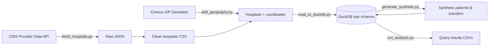

# California Hospital Transfer Analytics

An end-to-end data pipeline and SQL analysis of inter-hospital patient transfers across California. It combines **real hospital data** pulled from the CMS Provider Data API with **real geography** from the U.S. Census Bureau and **synthetic transfer records**, loads everything into a DuckDB star schema, and analyzes transfer volume, routing, response times, and transport performance.

This is a rebuild of an earlier group project (originally MySQL on AWS RDS), redesigned from scratch with an API-based ingestion pipeline, a new schema, and reproducible synthetic data.

## Architecture



## Tech Stack

- **Python:** pandas, NumPy, requests
- **Database:** DuckDB (local analytical database)
- **SQL:** CTEs, window functions, multi-table joins, percentile aggregates
- **Data sources:** REST API ingestion with pagination and retries

## Data Sources

| Data | Source | Type |
|---|---|---|
| 377 California hospitals (type, ownership, ER status, CMS star rating) | [CMS Provider Data API](https://data.cms.gov/provider-data/) (Hospital General Information) | Real |
| Hospital coordinates from ZIP code centroids | [U.S. Census Bureau ZCTA Gazetteer](https://www.census.gov/geographies/reference-files/time-series/geo/gazetteer-files.html) | Real |
| 9,000 transfers, 6,000 patients, 5 transport modes | Generated by `generate_synthetic.py` | Synthetic |

No real patient data is used anywhere in this project.

Real patient transfer records are protected health information under HIPAA, and de-identified research data requires data use agreements that don't permit public projects, so transfers are synthetic.

## Data Model

A star schema with one fact table and three dimension tables:

- **`fact_transfer`:** one row per transfer request: origin and destination hospitals, transport mode, distance, reason, acuity (1 = most critical, 5 = least), status, and four timestamps (requested, dispatched, picked up, arrived)
- **`dim_hospital`:** real CMS hospital attributes plus coordinates
- **`dim_patient`:** synthetic demographic bands (age band, sex, insurance type)
- **`dim_transport_mode`:** ground BLS, ground ALS, critical care ground, rotor air, fixed-wing air

Full definitions are in [`schema.sql`](schema.sql).

## How to Run

Requires Python 3.10+.

```bash
pip install -r requirements.txt

python fetch_hospitals.py      # 1. Pull hospitals from the CMS API
python add_geography.py        # 2. Add coordinates from Census ZIP data
python load_to_duckdb.py       # 3. Build the database and load hospitals
python generate_synthetic.py   # 4. Generate patients and transfers
python run_analysis.py         # 5. Run all queries in analysis.sql
```

Every step can be rerun safely: the database is rebuilt from scratch on each load, and the synthetic data uses a fixed random seed, so results are identical on every run.

## Project Structure

```
├── fetch_hospitals.py       # Extract: CMS API → raw JSON → clean CSV
├── add_geography.py         # Enrich: join Census ZIP coordinates
├── load_to_duckdb.py        # Load: create schema, load hospitals, verify
├── generate_synthetic.py    # Generate: patients, modes, geographically routed transfers
├── run_analysis.py          # Run every query in analysis.sql, save results
├── schema.sql               # Star schema definitions
├── analysis.sql             # Analysis and data quality queries
├── results/                 # Query outputs as CSV
└── requirements.txt
```

## Key Findings

<!--
TODO (Spri): Add your findings here, one per bullet or short paragraph.
Pattern: number + comparison + so what.
Include: day vs. night dispatch, neonatal routing, rotor air vs. critical care ground.
Optional: dispatch time by acuity, or regional hub concentration.
-->

## Limitations

<!--
TODO (Spri): Add limitations here. Things to cover:
- Which data is real vs. synthetic
- Hub selection within a region is randomized (CMS data has no trauma level designations or bed counts)
- Neonatal routing to children's hospitals is randomized at 80%, independent of acuity
- Distances are straight lines between ZIP code centers, not exact hospital addresses
- 7 hospitals had no ZIP match and use their county's average location
-->

## Engineering Notes

Design decisions worth calling out:

- **Raw and clean layers.** The untouched API response is saved before cleaning, so the cleaning logic can be changed and rerun without calling the API again.
- **Resilient API ingestion.** The CMS API returns at most 500 rows per request, so the extractor paginates through all ~5,400 hospitals and retries automatically on rate limits (HTTP 429) and server errors with exponential backoff.
- **Preserving identifiers.** CMS hospital IDs and ZIP codes have leading zeros (e.g., `050001`). They are explicitly typed as text throughout, since numeric parsing would silently corrupt them and break joins.
- **Defensive file parsing.** The Census file's delimiter has changed between releases, so the script detects it from the header line instead of assuming, and failures report the columns actually found.
- **Geographic routing.** Destinations are chosen by hub attractiveness weighted by exponential distance decay, using haversine distances between hospitals. An earlier version ignored geography and produced unrealistic 450-mile routes; validating results against real-world knowledge caught it.
- **Built-in data quality checks.** `analysis.sql` includes checks that should always return zero (completed transfers missing arrival times, arrivals before pickups, self-transfers, orphaned hospital IDs).

## Next Steps

- Migrate the warehouse to Snowflake and rebuild transformations as dbt models, with the data quality checks as dbt tests
- Build a Power BI dashboard on the query results
